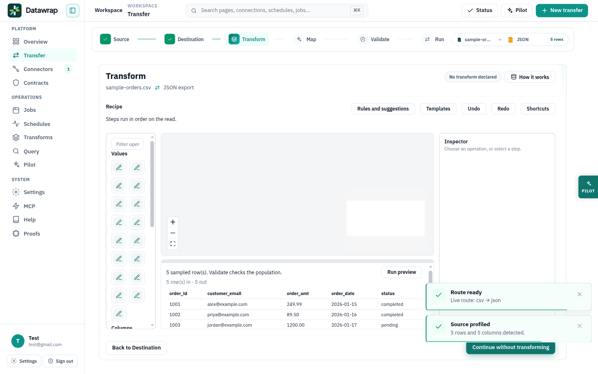
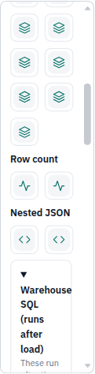
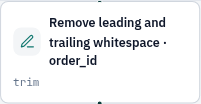
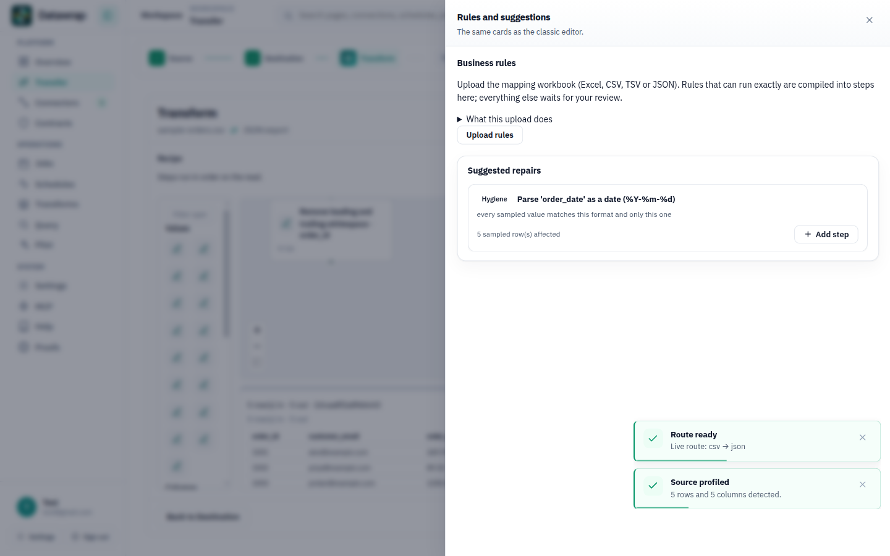
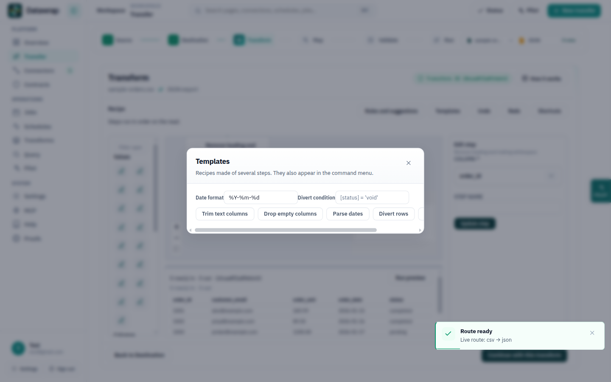
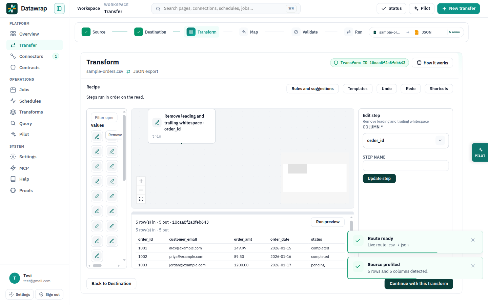

# Canvas research — pipeline editors

This note is the transform canvas inside Transfer Studio. It is not a second
product shell. `studio_canvas` and `studio_schema_browser` stay default
**off**. The wizard step list is unchanged.

The recipe is an ordered list of row-local steps. Edges mean order. A cycle
cannot be stored. Post-load SQL (join, aggregate) is not a step; it stays a
plan card that links to SQL models. The engine still runs the list. That
constraint filters every pattern below. A tool that draws an arbitrary DAG,
a runtime status grid, or a warehouse SQL IDE is a contrast, and a poor
thing to copy onto this surface until the engine can run it.

Code the mapping refers to:

- Palette, inspector, dock, drawers: `apps/web/src/components/transfer/TransferTransformCanvas.tsx`
- Chain model and the four family icons: `apps/web/src/lib/canvasDocument.ts` (`familyIcon`)
- Surface: `apps/web/src/components/transfer/TransformFlow.tsx` (xyflow, loaded only when the flag is on)
- Families: Values, Columns, Row count, Nested JSON (`operationsByFamily` in `apps/web/src/lib/shape.ts`)

Image pixels from vendor docs are not reproduced. Layout claims are the
captions and region tables on the cited pages. The screenshots in
`docs/design/canvas-audit/` are our own flagged Transform step, captured
13 Oct 2026 in headed Chromium at 1440×900.

## Flow and actions audit (13 Oct 2026)

Headed Chromium, canvas flag on (browser key and a stubbed workspace
settings response). Path: preview the workspace, load the sample orders
CSV, continue to Destination, choose File export, continue to Transform.
Every visible button, input, and summary was read from the DOM, then the
drawers were opened.

### How a transform gets built

1. The wizard is already on step 3. Source and destination are done. The
   step rail shows 1 Source through 6 Run. Transform is the current step
   and its own rail button is disabled.
2. The stage is empty: “Drop a step onto the canvas.” The left rail is the
   catalog. The right side says “Choose an operation, or select a step.”
3. Clicking a palette tile (or dropping it) commits that operation when it
   needs no extra fields. Trim did this: a node appeared, the inspector
   showed the column, and the footer changed from “Continue without
   transforming” to “Continue with this transform.”
4. The preview dock under the stage says the rows are a sample, shows an
   effect line, and has Run preview.
5. Continue leaves the step for Map. Back returns to Destination.

That spine is coherent. The clutter is everything else that also adds a
step, and a palette that does not say what the tiles are.

### Where the actions sit, top to bottom

Page chrome, shared with every wizard step:

- App sidebar and top bar (Search workspace, account, Pilot, New transfer).
- Step rail: 1 Source, 2 Destination, 3 Transform, 4 Map, 5 Validate, 6 Run.
- Transform title row: route, transform id, **How it works**.

Canvas header, one row of equal buttons:

- Rules and suggestions
- Templates
- Undo
- Redo
- Keyboard shortcuts

Left rail:

- Filter operations
- Four families (Values, Columns, Row count, Nested JSON), 30 icon tiles.
  On this pass the tiles were Remove leading and trailing whitespace
  through Flatten JSON. The names are the accessible name and the hover
  tip. The tile itself is a 36px icon.
- Warehouse SQL, a closed disclosure at the bottom of that scrolling rail.

Stage:

- xyflow Zoom in, Zoom out, Fit view, stacked at the left edge of the stage.
- A view-only minimap (hidden under 767px).
- No context menu. Right-click on the Trim node opened nothing.

Right inspector, after a step exists:

- Column picker (rendered as a button whose label is the column, `order_id`
  on the sample).
- Step name, error policy, and other fields for the operation.
- Update step. Discard appears only for a pending, uncommitted node.

Preview dock:

- Resize grip, status line, Run preview, sample table.

Page footer:

- Back to Destination
- Continue without transforming, or Continue with this transform once a
  step is in the recipe.

Drawers and dialogs, each a second copy of “add something”:

- Rules and suggestions: upload rules, the suggestion list (Add step on a
  suggestion), and the rule ledger.
- Templates: date format, divert condition, and five recipes (Trim text
  columns, Drop empty columns, Parse dates, Divert rows, Hash identity key).
- Keyboard shortcuts lists Ctrl+K, but the command palette has no button.
  Ctrl+K is handled on the canvas element, so it does nothing until that
  element has focus. There is no visible way to discover it.

### What works

- The wizard order is obvious, and the footer is the only way forward or
  back. After the layout fix the bar sits under the canvas, not on it.
- Drop and click both produce a node, and the inspector is the place that
  names the column.
- Illegal links are refused. Undo and redo are present.
- The dock says the grid is a sample, which matches the honesty bar.
- Warehouse SQL stays collapsed and is not a node.

### What is confusing

The header treats five different jobs as one toolbar. Rules, templates,
undo, and help are the same visual weight, and they sit above the stage
before the operator has a node.

The catalog is a grid of lookalike marks. Four family icons
(`edit`, `layers`, `activity`, `code`) cover all 30 operations. Row count
and Nested JSON sit further down the scrolling rail, so the first screen
is mostly the Values family with no visible type name on the tile.

A committed node is a white card: a small family glyph, a title, and the
op code underneath. Trim, case, and pad would share the pencil. Nothing
in the shape says filter versus expression versus hash.

Adding a step can start from the rail, from a suggestion in the rules
drawer, from a template dialog, or from the command palette. The drawer
and the dialog are both labeled as if they were the next thing to do.

Zoom lives in an unlabeled stack on the stage. Fit does not run when the
canvas opens. There is no Arrange control. Right-click does nothing, so
delete is the Delete key listed only in the shortcuts dialog.

The inspector’s column control reads as a loose button (`order_id`) rather
than a field labeled Column. Update step is correct once you are there,
and easy to miss beside the header buttons.

### Recommended action layout

One job per zone. The forward path stays the page footer.

| Zone | What belongs there | What leaves |
| --- | --- | --- |
| Page chrome | Step rail, How it works, transform id | Canvas editing controls |
| Palette | Filter, family groups, one row per operation with its icon and short name, Warehouse SQL closed at the bottom | Templates, suggestions |
| Canvas toolbar | Undo, redo, fit, and later Arrange. Shortcuts as the `?` control | Rules, Templates |
| Node | The step itself. A context menu with Configure, Duplicate, and Delete | A second form |
| Inspector | Column, options, error policy, step name, Add or Update, Discard | Continue |
| Preview dock | Sample status, effect line, Run preview, the row grid | A second Continue |
| Page footer | Back to Destination, Continue | Review result (that button is the flag-off path) |
| One overlay | Ctrl+K, once the canvas is focused, listing operations and the five templates | A Templates button and a second add path |
| Rules drawer | Upload, suggestions, ledger. Opened from one button, not from the editing toolbar | Being the first control in the header |

Rationale: IDMC, Talend, SSIS, and dbt Canvas all put “what can I add” on
one side and “configure the selection” on the other. Undo, zoom, and
arrange sit on the canvas, not in a row with help and imports. Continue
is the wizard’s, and it already changes its label when the recipe is
empty. The rules drawer is the right home for suggestions because those
cards already exist for the classic editor; they should not also be a
header peer of Undo.

## Competitor canvases — the full option set

“Yes” below means the cited page describes that control. “Not in these
pages” means the pages used for this note do not document it. It is not
a claim that the product lacks it forever.

### Informatica IDMC Mapping Designer and PowerCenter

Sources:

- [Mapping Designer](https://docs.informatica.com/integration-cloud/data-integration/current-version/mappings/mappings/mapping-designer.html) (region table)
- [Mapping validation](https://docs.informatica.com/integration-cloud/data-integration/current-version/mappings/mappings/mapping-validation.html)
- [Preview behavior](https://docs.informatica.com/integration-cloud/data-integration/current-version/mappings/mappings/data-preview-in-mappings/preview-behavior-for-a-mapping.html)
- July 2026 mappings PDF, same region table: `CDI_July2026_Mappings_en.pdf`
- [PowerCenter 10.5.7 connecting objects](https://docs.informatica.com/data-integration/powercenter/10-5-7/designer-guide/mappings/connecting-mapping-objects.html)
- [CDI-PC Designer toolbars](https://docs.informatica.com/integration-cloud/cloud-data-integration-for-powercenter/current-version/designer-guide/using-the-designer/using-toolbars/designer-toolbars.html)

IDMC Mapping Designer, from the region table:

1. Properties panel for the selected transformation. It can be resized, or
   swapped so only the canvas or only the properties show.
2. Header: mapping name, Valid or Invalid, Switch to Advanced, Save, Run
   (a test run), undo and redo until save, Inventory, Parameters,
   Validation, SQL ELT Query, Actions (create a mapping task, data-flow
   run order, stored-procedure order), Close.
3. Transformation palette. Drag onto the canvas. A new mapping already has
   a Source and a Target.
4. Canvas.
5. Toolbar: CLAIRE recommendation toggle (only if the org turned it on),
   Arrange All, Delete, Cut, Copy, Paste, Zoom in, Zoom out.
6. Validation panel. Lists transformations and errors. An error icon sits
   on the object. Clicking a name selects it. Validation runs on save.
7. Bird’s Eye View. Overview of the mapping plus highlighted field lineage,
   and a navigation pane that scrolls the canvas.

Also documented: drop between two linked transformations inserts and
connects the new one. Copy and paste works inside a mapping and across
open mappings and mapplets; pasted attributes come along, parameter values
do not. Preview runs only when the selected transformation and everything
upstream are valid, and it shows that transformation and the upstream
results. Some types cannot be previewed (the preview page names Data
Masking, Sequence, and Target among them). SQL ELT mode hides Run and puts
the generated query behind the panel toggle.

PowerCenter adds typed ports. Sources have only output ports, targets only
input ports, transformations a mix of input, output, and input/output. A
link is stored only when validation passes; a refused link draws a symbol
and does not become an edge. Unconnected ports are allowed and ignored at
runtime. The Designer toolbars cover arrange, zoom, copy of mapping
segments, and mapping comments. Those comments are on the mapping, not
sticky notes on the canvas. Breakpoints are not part of the mapping
designer; a test run is.

### Talend Studio 8 job designer

Sources:

- [Adding components](https://help.qlik.com/talend/en-US/studio-user-guide/8.0-R2025-12/adding-components-to-job)
- [Outline](https://help.qlik.com/talend/en-US/studio-user-guide/8.0-R2024-08/outline)
- [Navigating the canvas](https://help.qlik.com/talend/en-US/studio-user-guide/8.0-R2026-08/navigating-the-canvas) (updated 2026-08-27)
- [Notes](https://help.qlik.com/talend/en-US/studio-user-guide/8.0-R2026-05/adding-notes-to-job-design)
- [Breakpoints](https://help.qlik.com/talend/en-US/studio-user-guide/8.0-R2026-02/breakpoint-monitoring)
- [Data viewer](https://help.qlik.com/talend/en-US/studio-user-guide/8.0-R2026-07/viewing-in-process-data)
- [Views](https://help.qlik.com/talend/en-US/discovering-talend-studio/8.0/inside-talend-studio)

Palette search accepts a partial name or a phrase (“read file row by
row”) and collapses families that do not match. You can also type on the
canvas, or drag the arrow out of a component and pick a component that is
legal on that link. The new component arrives already connected.

Outline is the bird’s-eye: a blue rectangle shows the visible part of the
job, and dragging it pans the canvas. The same panel can switch to a tree
of the components and their variables. Select mode is the default; holding
the wheel or Space pans, and releasing returns to select. Move mode pans
and does not select.

Notes are a Misc palette item. Font, color, opacity, and alignment are
edited in the Component view. They are design comments, not components
that run.

Breakpoints attach to a link (Show Breakpoint Setup, conditional
conditions). Traces Debug runs to the next breakpoint, Next Breakpoint
continues, Kill stops, Basic Run finishes, Clear removes the trace
overlay. A pause mark is drawn on the link. Data Viewer opens on a
row component with a row limit. Row links carry data; trigger links carry
control. The component’s own icon is drawn on the node; the label is the
component code (`tMap`, `tFileInputDelimited`).

Zoom percentage, Arrange All, and a validation-badge panel are not in the
pages above. Grouping of nodes is not in those pages.

### SSIS data flow

Sources:

- [SSIS Designer](https://learn.microsoft.com/en-us/sql/integration-services/ssis-designer?view=sql-server-ver17)
- [Data Flow](https://learn.microsoft.com/en-us/sql/integration-services/data-flow/data-flow?view=sql-server-ver17)
- [Paths](https://learn.microsoft.com/en-us/sql/integration-services/data-flow/integration-services-paths?view=sql-server-ver17)
- [Data Viewer](https://learn.microsoft.com/en-us/sql/integration-services/data-flow/data-viewer?view=sql-server-ver17)
- [Debugging data flow](https://learn.microsoft.com/en-us/sql/integration-services/troubleshooting/debugging-data-flow?view=sql-server-ver17)
- [Group or ungroup](https://learn.microsoft.com/en-us/sql/integration-services/group-or-ungroup-components?view=sql-server-ver17)
- [Annotations](https://learn.microsoft.com/en-us/sql/integration-services/use-annotations-in-packages?view=sql-server-ver17)
- [Copy and paste](https://learn.microsoft.com/en-us/sql/integration-services/reuse-of-package-objects?view=sql-server-ver17)

Control flow and data flow are different surfaces. Data flow is sources,
transformations, and destinations, joined by paths. The toolbox is
grouped. Each component has its own icon. A path is an object: metadata,
an annotation, and an optional data viewer. The error output is a
different path from the main output. Conditional Split can carry a viewer
on each output.

A data viewer shows a grid buffer by buffer and pauses the flow until you
continue. Detach stops updating the grid without deleting the viewer.
Copy Data copies the current buffer. That pause is the data-flow
equivalent of a breakpoint. Control-flow breakpoints are the other
surface.

Grouping is design-time only. Select several components, Group, then
expand or collapse. Groups can nest. Saving the package stores the group,
and the group does not change execution. Annotations are free text on the
design surface (Add Annotation, Set Text Annotation Font). They are not
written to logs.

Copy and paste works across packages and projects for control-flow items,
data-flow items, and connection managers. Pasted objects get a new id.
Variables are not copied with a single object. A data flow cannot be
pasted into a package that has no Data Flow task.

A minimap is not in these pages. Field-level ports are not drawn on the
component; the path carries the column list.

### Airflow 3.3 UI

Source: [UI Overview](https://airflow.apache.org/docs/apache-airflow/stable/ui.html)
(Airflow 3.3.2) and the 3.3 release notes for grid notes, graph filters,
and the `?` shortcut dialog.

This is a viewer of a Dag that already exists in code. It is not a design
canvas.

- Graph: tasks as nodes, dependencies as edges. Click a node for metadata
  and recent runs. The graph can be filtered (operator, task group, mapped
  index, and, for a selected run, status and duration). Non-matching nodes
  dim rather than disappear.
- Grid: tasks by run, color for state, click through to logs. This is the
  debug surface. A note indicator can sit on a run or task instance.
- Code tab: the Dag as parsed.
- Asset graph: upstream producers and downstream consumers, recent events,
  manual event trigger. Overlays on the Dag graph show asset edges. This
  is the lineage view, and it is not the editor.
- Dag actions: trigger, reparse, pause. Task actions live on the grid and
  the details panel (logs, retry), not as “run from this node” on a
  design canvas.
- `?` opens keyboard help.

There is no palette, no drop, no copy of a task in the UI, no field ports,
and no breakpoint on the graph. State color means success, failed, and the
other run states. That language belongs on Jobs, not on a recipe that has
not run.

### dbt Cloud Canvas

Sources:

- [Edit and create models](https://docs.getdbt.com/docs/platform/use-canvas)
- [Canvas interface](https://docs.getdbt.com/docs/platform/canvas-interface)
- [Canvas quickstart](https://docs.getdbt.com/guides/canvas)
- [About Canvas](https://docs.getdbt.com/docs/platform/canvas)
- IDE lineage and Catalog are different objects:
  [IDE](https://docs.getdbt.com/docs/platform/studio-ide/ide-user-interface),
  [Catalog](https://docs.getdbt.com/docs/explore/explore-projects)

Canvas is a visual model builder:

- Operator toolbar grouped as Input, Transform, and Output.
- Drag an operator onto the canvas. Click it. The configuration panel has
  Configure, and the operator can show Input, Output, and Code. Output is
  the preview of that node. Code is the SQL the configuration generates.
- A play control on the tile previews that point in the flow. The tile
  shows how many columns are present there. The tile menu can delete it.
- Connect by dragging from a “+” handle. The line is the flow from source
  through transforms to the output model.
- Left-edge navigation: zoom in, zoom out, fit the model, zoom to the
  selected operator, auto-layout of the tiles.
- Runs pane for warnings and errors. The interface page lists test and
  document as coming later.
- Models compile to SQL, are versioned in Git, and can be built in a
  development schema. You cannot invent a source that has never been run
  in production.

A minimap, copy/paste, grouping, canvas comments, breakpoints, and
field-level ports are not in these pages. Lineage of the whole project is
Catalog and the IDE lineage tab, not the canvas. The IDE lineage tab shows
two levels upstream and downstream and opens the file on double-click.

## Feature matrix

| Capability | IDMC Mapping Designer | Talend Studio 8 | SSIS data flow | Airflow 3.3 | dbt Canvas | DataFlow canvas now |
| --- | --- | --- | --- | --- | --- | --- |
| What it is | Mapping editor | Job editor | Package editor | Dag viewer | Model editor | Row-recipe editor, flag off by default |
| Minimap / overview | Bird’s eye, pans the canvas, draws field lineage | Outline rectangle and component tree | Not in the cited pages | Not in the UI overview | Not in the cited pages | xyflow minimap, not editable, hidden under 767px |
| Zoom | Zoom in, zoom out | Not in the cited pages | Not in the cited pages | Not a documented toolbar | Zoom in, zoom out, zoom to selection | Zoom in, zoom out |
| Fit | Not named in the toolbar table | Not in the cited pages | Not in the cited pages | Panel gesture, not the overview page | Fit the model | Fit view button; does not run on open |
| Auto-layout | Arrange All | Not in the cited pages | Not in the cited pages | No | Auto-layout of tiles | Drag snaps back to the chain. No Arrange button |
| Palette search | Named transformation palette; search is not in the region table | Name or phrase; families collapse | Toolbox groups (search is the IDE’s) | No palette | Toolbar groups: Input, Transform, Output | Filter box. Tiles do not print the name |
| Icon per type | One icon and a short name per transformation | The component’s own icon; code is the label | One icon per component | Task name; color is run state | Operator tile, plus a play mark and a column count | Four family icons for 30 operations |
| Source and target nodes | Yes, on a new mapping | Components you add | Source and destination components | No | Input and output operators | No. Those are wizard steps |
| Field-level ports | PowerCenter yes. IDMC uses field lineage, not a port grid | Schema on the link, not a port per column | Columns live on the path | No | Column list in the operator, not ports | One in-port and one out-port |
| Join, lookup, aggregate | Real transformations | Real components (`tMap` and others) | Real components | Not a transform canvas | Transform operators | Plan cards under Warehouse SQL. The list cannot store two inputs |
| Per-node preview | Preview panel of the selected transformation and its upstream | Data Viewer on the component | Data viewer on a path, buffer by buffer | Logs for a task, not a design preview | Play on the tile; Output tab | One dock for the whole recipe sample |
| Validation | Header Valid/Invalid, error icon, validation list | Component view | Design-time errors and warnings on the component | Run state on the grid | Runs pane; tests called out as later | Invalid pending node only. No list |
| Copy / paste | Cut, copy, paste, including across mappings | Not in the cited pages | Yes, across packages | No | Not in the cited pages | No |
| Grouping | Not in the region table | Not in the cited pages | Yes, design-time, no effect on execution | Task groups in the Dag | Not in the cited pages | No |
| Comments | PowerCenter: comments on the mapping | Note item on the canvas | Annotation on the surface | Note indicator on the grid | Not in the cited pages | No |
| Run from the canvas | Run starts a test | Run view, separate from the palette | Debugger / package run | Trigger the Dag | Preview does not build production | Continue goes to Map. Run preview refreshes the sample |
| Run from a node | Preview is “this node and upstream,” not a partial job | Traces stop at a breakpoint | Data viewer pauses at a path | Task retry and logs | Play previews that operator | No |
| Breakpoints | No | Yes, on a link, with Traces Debug | Data viewer pauses the data flow; control-flow breakpoints are the other tab | No | No | No |
| Lineage | Bird’s eye field lineage | Not this canvas | Path metadata | Asset graph, separate from editing | Catalog and the IDE lineage tab | This recipe only. Other tables are dimmed |
| Undo | Until save | Studio undo | Visual Studio undo | No | Not in the cited pages | Undo and redo in the header |
| Context menu | Drop-on-link adds a transformation | Right-click a link for breakpoints | Right-click to group, annotate, copy, add a viewer | Click opens details | Tile menu deletes; click opens the panel | Right-click does nothing |

## Node treatment

Research only. This pass does not change the node component. The action-bar
fix did not need a new glyph, and a new icon set would have to stay behind
the canvas flag so the classic step stays pixel-identical.

### How the others draw a type

- IDMC and PowerCenter: the palette and the node share one icon and a short
  name per transformation (Expression, Filter, Joiner, Lookup, Aggregator,
  and the rest). Status is a separate mark: the validation error icon, and
  Valid or Invalid on the mapping, not a recolor of the whole node.
  PowerCenter adds ports by role (input, output, input/output), not a
  unique shape per type.
- Talend: the component icon is the identity. The text under it is the
  component code. Notes are a different object, with their own font and
  border, so a comment cannot be mistaken for a step. A breakpoint is a
  small mark on the link.
- SSIS: the toolbox icon is the identity (source, transform, destination).
  The path is the second object. A data-viewer icon sits on the path you
  are inspecting. The error output is a different path, not a different
  card shape. Groups and annotations are containers and text, and they do
  not run.
- dbt Canvas: the tile is the operator, the play mark means “preview
  here,” and the column count says how wide the frame is at that point.
  Input, Transform, and Output are toolbar groups, so the category is
  where you picked it up as well as what the tile looks like.
- Airflow: color means run state. That is the wrong code for a recipe that
  has not executed.

### What we draw today

`familyIcon` returns one of four glyphs: Values `edit`, Columns `layers`,
Row count `activity`, Nested JSON `code`. The palette tile and the node
both use it. An invalid pending node swaps in `alert`. The card is a
200×72 surface with a 1px border, a 2px brand border when selected, and a
dashed border when dimmed, disabled, or invalid. The out-port gets a
different class when the step changes row count. There is no per-operation
icon and no category color.

### Recommendation

Keep one card shape. Identity comes from the icon and a category stripe,
not from a zoo of shapes. Source and target stay off this canvas until the
wizard stops owning them. Field ports stay off. Join, lookup, and
aggregate stay off the canvas until the set-based engine can run a
multi-input step; drawing them earlier would show a run the transfer
cannot do.

Category color, from the existing logo tokens in `tokens.css`. No new hex
values.

| Family | Token | Hex already in the token | Use |
| --- | --- | --- | --- |
| Values (trim, case, parse, expression) | `--df-brand-tile` | `#0A3D3A` | Icon well and a 3px leading stripe |
| Columns (rename, cast, derive, drop) | `--df-brand-text` | `#0F766E` | Same |
| Row count (filter, divert, hash) | `--df-brand-arrow` | `#2DD4BF` | Stripe only. The icon well stays `--df-brand-tile` so the glyph keeps contrast |
| Nested JSON, and Warehouse SQL cards | `--df-attention` | `#F59E0B` | Stripe. These are the steps that change shape, or that are not steps |

Icon per operation, shared by the palette tile and the node. The family
glyph remains the fallback if an op has no picture yet. The set to draw
first, because those are the words operators already use:

| Operation | Icon idea | Family stripe |
| --- | --- | --- |
| Filter rows | funnel | Row count |
| Divert rows | split arrow | Row count |
| Expression / set value | pencil on a line | Values |
| Rename, cast | tag, or a type mark | Columns |
| Join | two bars into one | Not drawn until the engine has two inputs |
| Lookup | magnifier on a table | Same |
| Aggregate | sigma | Same, Warehouse SQL until then |
| Sort | up/down bars | Columns, when the op exists |
| Dedupe / hash identity | fingerprint | Row count |
| SQL / plan card | code mark, attention stripe | Not a canvas node |

Ports stay as they are: one target on top, one source on the bottom. The
row-count source keeps its own class and uses the arrow token. Status is
a badge, not a new shape: alert on an invalid pending node, dashed border
on a dimmed other-table step, 2px brand border on the selection. Run state
(success, failed) does not appear here.

Palette row, once the icon exists: icon, short name, family as a quiet
label. The 36px unlabeled grid is what makes the rail look like random
boxes. The filter box stays.

## Patterns to adopt

| Pattern | Where it is proven | DataFlow use |
| --- | --- | --- |
| Full-page canvas, inspector on the selection | IDMC properties; dbt configuration panel | Canvas is the transform step body. Inspector stays on the right. |
| One icon and a short name per type | IDMC palette; Talend component icon; SSIS toolbox; dbt tiles | Replace the four family glyphs as the only mark. Research only until a flag-gated pass. |
| Search that filters families | Talend palette | The filter box stays, and it should hide empty families. |
| Drop creates the object where you drop it | IDMC, Talend, SSIS, dbt | A drop or a click shows a node. An incomplete node stays visible and is not written into the recipe until the inspector commits. |
| Insert between two linked steps | IDMC drop on the link | A drop whose height falls between two nodes inserts there and the chain reconnects. |
| Arrange, then snap | IDMC Arrange All | Drag reorders by vertical position, then `layoutFor` snaps the chain. An Arrange button should call that same function. Positions are not a second source of truth. |
| Refused illegal links | PowerCenter; Talend’s connectable list; dbt “+” handle | Output of step *i* may link to input of step *i+1*. Anything else shows a reason and creates no edge. |
| Validation list | IDMC Validation panel | A refused step gets the alert badge and a row in a list that selects it. |
| Docked sample | dbt Output; SSIS data viewer; IDMC preview; Talend Data Viewer | The dock under the stage. It should name the step the sample is through, and keep the sentence that this is not the population. |
| Undo in the canvas toolbar | IDMC | Undo and redo stay. They move off the row that also holds Rules and Templates. |
| Notes that do not run | Talend Note; SSIS annotation | Only if the annotation cannot be stored as a step. Otherwise skip it. |
| Light and dark from the same tokens | Airflow theme toggle | `studio-next.css` stays on tokens. |

## Patterns to avoid

- Port-per-column nodes. PowerCenter’s ports are right for a mapping with
  hundreds of fields, and the wrong density for a step that already names
  its column in the inspector.
- Source and target nodes on this canvas. Those objects are earlier and
  later wizard steps.
- A second edge type, a group that changes execution, or a joiner drawn
  before the set-based engine can run two inputs.
- Airflow run-state colors on a design node.
- A SQL editor as the canvas. Warehouse SQL stays a collapsed disclosure.
- Five equal header buttons, and four ways to add a step.
- Saving an invalid step into the engine payload. Informatica can store a
  mapping whose status is Invalid. DataFlow must not hand a half-specified
  step to the transfer.
- Flipping either studio flag on by default, or changing the classic step
  list.

## What the last implementation pass already did

The older rows in this note described work that has since landed behind
the flag. Current behavior, so the next pass does not rebuild it:

| Item | Current behavior |
| --- | --- |
| Full page | The flagged canvas is the transform step body. Suggestions open in a drawer. The classic step list is unchanged with the flag off. |
| Drop and reorder | A drop places a node. Dragging reorders by vertical index, then the chain snaps. |
| Links | `classifyChainLink` accepts only the next step. A bad link shows a reason and does not change the list. |
| Preview | Dock under the stage: sample line, effect, Run preview. |
| Warehouse SQL | Closed `
` in the rail. Plan cards link to `#/transforms`. |
| Undo | Header buttons and Ctrl+Z. A keystroke is not a history entry. |
| Footer | Back and Continue are a static row under the canvas when the flag is on. The classic sticky footer is unchanged. |

Still open, in the order from the action audit: one icon and a printed
name per operation, Arrange and fit-on-open, a validation list, the dock
naming which step the sample is through, copy of a single step, and a
node menu with Delete. Join and lookup wait on the set-based engine.

## Sources not used

Unofficial blog screenshots and undated YouTube walkthroughs. Where a doc
page offered Watch, the written region table was the source.
